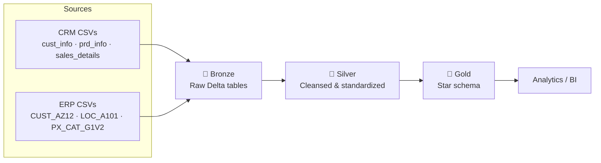

# 🚴 Databricks Lakehouse: Bike Sales Data

> An end-to-end **Lakehouse** built on **Databricks**, **PySpark**, and **Delta Lake** using the **Medallion Architecture** (Bronze → Silver → Gold). It ingests raw CRM and ERP data and produces a star schema ready for analytics.


---

## Overview

This project rebuilds a classic sales data warehouse as a **Databricks Lakehouse**. Six raw CSV files from two source systems (**CRM** and **ERP**) are ingested into Delta tables, cleansed and standardized with PySpark, and integrated into a star schema.

**Highlights:**

- Config-driven Bronze ingestion: add a new source by adding one entry to a list.
- One notebook per table in Silver and Gold, so each step is easy to read, test, and re-run.
- Gold layer orchestrated from a single entry-point notebook, ready to schedule as a Databricks Job.
- All tables stored in **Delta format** under Unity Catalog.

---
 
## 🏗️ Architecture
 

 
| Layer | Schema | Purpose | Transformations |
|-------|--------|---------|-----------------|
| 🥉 **Bronze** | `workspace.bronze` | Raw data as received | None (schema inferred, full overwrite) |
| 🥈 **Silver** | `workspace.silver` | Clean, consistent data | Trimming, normalization, type casting, validation, renaming |
| 🥇 **Gold** | `workspace.gold` | Business-ready model | Joins, surrogate keys, integration of CRM + ERP |
 
---

## 🛠️ Tech Stack

| Tool | Purpose |
|------|---------|
| **Databricks** | Unified data platform and notebook environment |
| **PySpark** | Distributed data processing |
| **Delta Lake** | Storage format for all tables |
| **Spark SQL** | Gold layer transformation logic |
| **Unity Catalog Volumes** | Storage for raw source files |
| **Git & GitHub** | Version control |

---

## Repository Structure

```
databricks_lakehouse_2026/
│
├── source_crm/                         # Raw CRM data
│   ├── cust_info.csv
│   ├── prd_info.csv
│   └── sales_details.csv
│
├── source_erp/                         # Raw ERP data
│   ├── CUST_AZ12.csv
│   ├── LOC_A101.csv
│   └── PX_CAT_G1V2.csv
│
├── bike_lakehouse/
│   ├── Bronze/
│   │   ├── bronze_config.py            # Source → target ingestion config
│   │   └── bronze.ipynb                # Generic ingestion loop
│   │
│   ├── Silver/
│   │   ├── crm/                        # silver_crm_cust_info, _prd_info, _sales_details
│   │   └── erp/                        # silver_erp_cust_az12, _loc_a101, _px_cat_g1v2
│   │
│   └── gold/
│       ├── gold_dim_customers.ipynb
│       ├── gold_dim_products.ipynb
│       ├── gold_fact_sales.ipynb
│       └── gold_orchestration.ipynb    # Runs all Gold notebooks in order
│
├── LICENSE
└── README.md
```

---

## Getting Started

### Prerequisites

- A Databricks workspace with **Unity Catalog** enabled (the free edition works)
- A catalog named `workspace` (the default in the free edition)

### Setup

1. **Clone the repo into Databricks**
   In your workspace go to **Workspace → Create → Git folder** and paste:
   ```
   https://github.com/Hossam-eldin55/databricks_lakehouse_2026.git
   ```

2. **Create the schemas**
   ```sql
   CREATE SCHEMA IF NOT EXISTS workspace.bronze;
   CREATE SCHEMA IF NOT EXISTS workspace.silver;
   CREATE SCHEMA IF NOT EXISTS workspace.gold;
   ```

3. **Create a volume and upload the source files**
   ```sql
   CREATE VOLUME IF NOT EXISTS workspace.bronze.source_systems;
   ```
   Upload `source_crm/` and `source_erp/` so the files end up at:
   ```
   /Volumes/workspace/bronze/source_systems/source_crm/*.csv
   /Volumes/workspace/bronze/source_systems/source_erp/*.csv
   ```
   If you use a different location, edit `Base_path` in `bike_lakehouse/Bronze/bronze_config.py`.

4. **Run the pipeline in order**

   | # | Notebook | Output |
   |---|----------|--------|
   | 1 | `Bronze/bronze.ipynb` | 6 raw tables in `bronze` |
   | 2 | All notebooks in `Silver/crm/` and `Silver/erp/` | 6 cleansed tables in `silver` |
   | 3 | `gold/gold_orchestration.ipynb` | `dim_customers`, `dim_products`, `fact_sales` in `gold` |

5. **Query the results**
   ```sql
   SELECT * FROM workspace.gold.fact_sales LIMIT 10;
   ```

---

## Pipeline Details

### 🥉 Bronze: Config-Driven Ingestion
`bronze_config.py` defines a list of `{source, path, target}` entries. `bronze.ipynb` loops through it, reads each CSV with header and schema inference, and writes it as a Delta table (overwrite mode).

### 🥈 Silver: Cleansing & Standardization

| Source Table | Silver Table | Key Transformations |
|--------------|--------------|---------------------|
| `crm_cust_info` | `crm_customers` | Trim strings; map `S/M` → Single/Married and `M/F` → Male/Female; rename columns |
| `crm_prd_info` | `crm_products` | Split product key into `cat_id` and key; fill null costs with 0; map product line codes (Mountain, Road, Touring, Other Sales); derive `end_date` with `LEAD()` |
| `crm_sales_details` | `crm_sales` | Convert `yyyyMMdd` integers to dates and null out invalid ones; recompute missing prices; recalculate sales as price × quantity |
| `erp_cust_az12` | `erp_customers` | Strip `NAS` prefix from IDs; null out future birthdates; normalize gender |
| `erp_loc_a101` | `erp_customer_location` | Remove hyphens from IDs; normalize country values (`DE`, `US`, `USA`); fill blanks with `n/a` |
| `erp_px_cat_g1v2` | `erp_product_category` | Convert maintenance Yes/No to a boolean flag; rename columns |

### 🥇 Gold: Dimensional Model
Each Gold notebook runs a Spark SQL query over Silver tables and writes a Delta table. `gold_orchestration.ipynb` runs the three notebooks in order with `dbutils.notebook.run()`, so it can serve as the single entry point for a scheduled Databricks Job.

---

## ⭐ Gold Data Model

| Table | Type | Description |
|-------|------|-------------|
| `gold.dim_customers` | Dimension | CRM customers enriched with ERP birthdate, gender fallback, and country |
| `gold.dim_products` | Dimension | CRM products enriched with ERP category, subcategory, and maintenance flag |
| `gold.fact_sales` | Fact | Sales transactions linked to customers and products through surrogate keys |

```
 dim_customers ───┐
                  ├──▶ fact_sales
 dim_products  ───┘
```

---

## 💡 Skills Demonstrated

- Lakehouse architecture and Medallion design
- PySpark DataFrame transformations and window functions
- Delta Lake table management
- Spark SQL for dimensional modeling
- Notebook orchestration with `dbutils`
- Data cleansing and standardization
